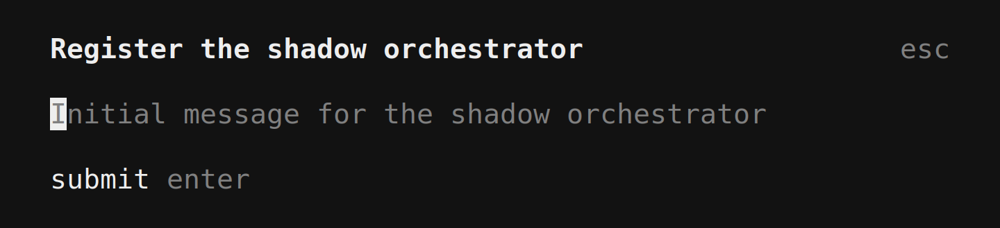
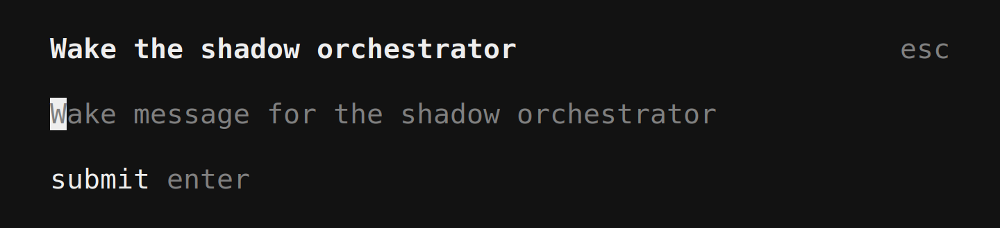

<p align="center">
  
</p>

<p align="center">
  An OpenCode v2 plugin that pairs a working session with a second "shadow orchestrator" session and wakes it with a command.
</p>

<p align="center">
  <a href="/LICENSE"></a>
  <a href="/package.json"></a>
</p>

---

**Contents**

- [Why it exists](#why-it-exists)
- [Features](#features)
- [Set it up](#set-it-up)
- [Limits](#limits)
- [License](#license)

## Why it exists

Working from a written plan suits large mechanical changes. Interface work is a stream of small
decisions, and the plan falls out of date while the interface changes.

This plugin adds a second session next to the working one. The working session makes the decisions.
The second session, the shadow orchestrator, holds the plan. When you wake it, it reviews the step
that was just finished and records any cleanup tasks.

## Features

### Register

`/shadow-register` starts an orchestrator session in the current workspace and binds it to that
workspace. A workspace is the git root of the current directory, or the directory itself outside a
repository. Each workspace has one binding, so registering again replaces it. The new session gets
the configured initial message and the model of the session you ran the command from, then waits for
a wake.

`/shadow-register-manual` does the same, but you type the initial message in a dialog instead of
using the configured one, and the new session uses the model selected in the terminal UI. The
terminal UI then opens the new session.



### Wake

`/shadow-wake` sends the configured wake message to the bound orchestrator session. The orchestrator
answers on its own model, agent and variant. The working session does not run a turn. The result
appears as a notice in the working session.

`/shadow-wake-manual` sends a message you type in a dialog instead, and shows the result as a toast.



If the workspace has no binding, the wake asks you to register. If the bound session is gone or
archived, the wake also clears the binding first. An empty dialog cancels the command.

| Command | What it does |
|---|---|
| `/shadow-register` | Starts a shadow orchestrator session for the current workspace |
| `/shadow-register-manual` | Starts one with a message you type |
| `/shadow-wake` | Wakes the shadow orchestrator for the current workspace |
| `/shadow-wake-manual` | Wakes it with a message you type |

### Messages per repository

The initial and wake messages come from `config.json`, and a repository can have its own. The
messages for a UI project can differ from the messages for a library.

### Bindings shared between processes

The bindings are stored in `state.json` next to the configuration file, so separate OpenCode
processes see the same registrations. The sessions and the prompts the plugin sends carry the
metadata `shadowOrchestrator: true`, so another plugin can recognize them.

### Edit without restarting

The plugin watches `config.json`. A saved change applies at once. A file with an error is rejected,
the previous settings stay in use, and the error is appended to `logFile` when it is set.

## Set it up

You need OpenCode v2. Node.js 18 or later is only needed to run the tests.

1. Copy the example configuration and edit the messages and repository entries:

   ```bash
   cp config.example.json config.json
   ```

2. Add the plugin directory to the `plugins` array in `opencode.json` or `opencode.jsonc`. The
   `config` option points at the configuration file.

   ```json
   {
     "plugins": [
       {
         "package": "/path/to/shadow-orchestrator",
         "options": {
           "config": "/path/to/shadow-orchestrator/config.json"
         }
       }
     ]
   }
   ```

3. Reload OpenCode.

The server part of the plugin provides the two automatic commands and the terminal UI part provides
the two manual ones. No files are needed in `~/.config/opencode/commands/`. `npm test` runs the
tests, which use a mock plugin context and need no network.

### Configuration

| Key | Type | Meaning |
|---|---|---|
| `logFile` | string | Optional. Log file path, relative to the configuration file. |
| `default.initial_message` | string | Required. Sent to a new orchestrator session. |
| `default.wake_message` | string | Required. Sent to the orchestrator on a wake. |
| `repositories` | object | Optional. Maps a directory to its own messages. |
| `paths` | object | Optional. An alias of `repositories`. When both name the same directory, `repositories` wins. |

A repository entry can set `initial_message`, `wake_message` or both, and a missing field uses the
value from `default`. A directory key can start with `~`, and a relative key is resolved against the
configuration directory. A workspace uses the entry with the longest matching path prefix, compared
by whole path segments.

```json
{
  "logFile": "shadow-orchestrator.log",
  "default": {
    "initial_message": "You are the Shadow Orchestrator for this workspace. Stay silent until you receive a wake message.",
    "wake_message": "Shadow orchestrator wake. Execute your assigned step."
  },
  "repositories": {
    "~/projects/ui-repo": {
      "wake_message": "Shadow orchestrator wake. Another UI step is complete."
    }
  }
}
```

`config.example.json` has fuller messages to start from.

## Limits

- The manual commands come from the terminal UI part. A client without it shows only the two
  automatic commands.
- Every wake starts a model run on the orchestrator's model, which costs tokens.
- Registering again does not close the previous orchestrator session. It only replaces the binding.
- An invalid configuration file at startup stops the plugin from loading.
- `logFile` is appended to and never rotated.

## License

This project is released under the [MIT License](/LICENSE).
